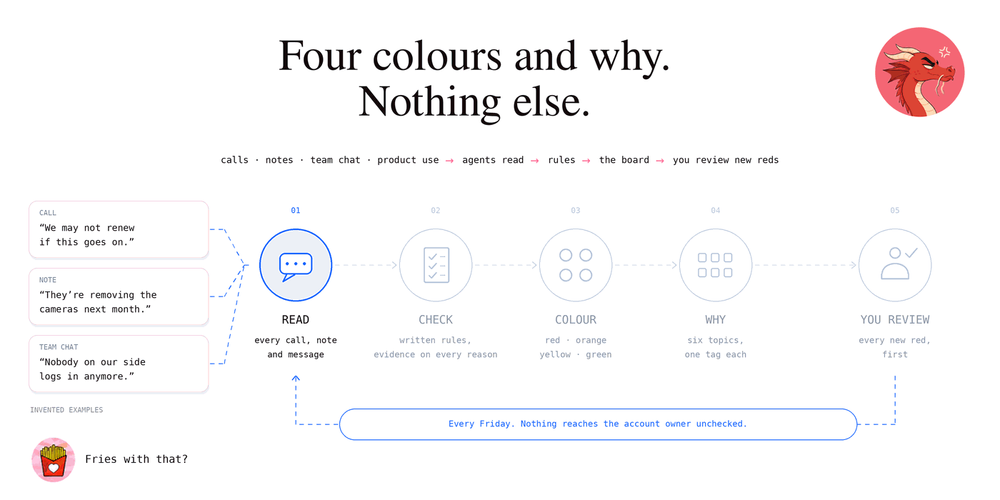
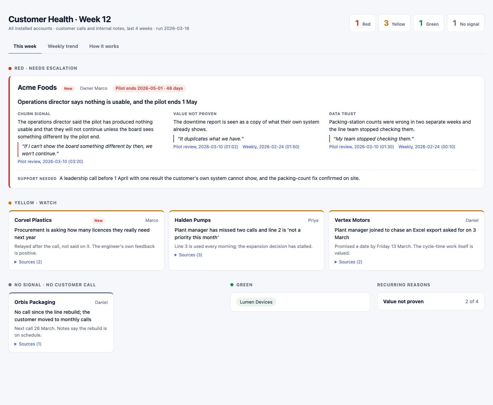

# Customer health agents

  

### Four colours and why. Nothing else.

<p align="center"></p>

**A weekly customer-health board for B2B accounts, built with AI agents: they read every customer
call, note, team chat message and product-use signal, and give each account red, orange, yellow or
green, with the reasons and the evidence. This repo is the product and the product thinking: the
rules, the code, six versions of iterating with its user, and everything that got cut on the way.**

*Companion projects: [**product-discovery-agents**](https://github.com/barbararomeira/product-discovery-agents) reads customer calls for what to build; [**evidence-scored-call-review**](https://github.com/barbararomeira/evidence-scored-call-review) reads them for how the sales conversation went. This one reads them for whether the account is staying.*

| | |
|---|---|
| **User** | Whoever owns customer success for an installed base, and the account owners who act on the board each week |
| **Job** | "Tell me which accounts need me this week, and why, without reading every call." |
| **Problem** | Churn risk hides in call tone, in who stopped turning up, in end dates nobody connected to the complaint, and in product use that quietly stopped. Health scores turn that into a number people argue with instead of act on. |
| **Product** | One board, four colours, and at most one tag per topic saying why. Every reason links to a quote, note or message. |
| **Human boundary** | The agents say which accounts are red and why. A person reviews every new red before anyone else sees it and decides the escalation. |
| **Status** | Rules **v0.6**. The weekly run was in real use from v0.2 onwards; every version since came from that use. Backtested on one account that had already left. |

---

## The product in one screen

<p align="center"></p>

**Four colours.** Checked in this order; the first match wins.

| | Means | Needs |
|---|---|---|
| 🔴 **Red** | Would likely leave without escalation | One churn signal or confirmed exit, **or** two warning signs that have each lasted 3+ weeks |
| 🟠 **Orange** | Something is wrong, and the clock is running | Anything yellow **and** the contract, pilot or renewal ends within 90 days |
| 🟡 **Yellow** | Watch | One warning sign, a young trend, an open ask, a late go-live, or no customer call |
| 🟢 **Green** | Healthy | A customer call in the window, tone normal or better, nothing serious open |

**Six topics say why.** At most one tag each, red against and green in favour. Tags explain the
colour; they never change it.

| Leaving | Contract | Tone | Product use | Go-live | Improvements |
|---|---|---|---|---|---|
| said they may stop · site is ending | ends in 46 days · end passed | worse than usual · gone quiet · no call — *or* as usual · warmer | stopped · not logging in · halved — *or* daily · regular | late · partial — *or* on time | not delivering · no value seen yet · numbers disputed · request unanswered |

## How it got here

Six versions in three weeks, each started by something the user said or something the data got wrong, and each
one took something out. The full story, with what we'd measure to know it works, is in
[**The product story**](docs/09-product-story.md).

| | Trigger | Change |
|---|---|---|
| **v0.1** | "We know about the loud accounts, not the quiet ones." | Agents read every call weekly against written rules |
| **v0.2** | A backtest gave **zero weeks of warning** on a real churn | Silence is never green; nearest end date includes pilot ends |
| **v0.3** | "Make every account near renewal yellow" would have mixed two meanings | **Orange** = wrong *and* ending soon; timing became a tag |
| **v0.4** | "We want daily use, but some customers get their reports by email" | Product use joins the same colours; only a collapse counts against |
| **v0.5** | An exit showed up only in a team chat. *"I just want red, orange, yellow, green, and why."* | Team chat as a source; the board cut to four colours and why |
| **v0.6** | Around twenty tag wordings. *"Do we need any more?"* | Six fixed topics, one tag each |

## Product decisions worth stealing

- **No score on the board.** People act on reasons and argue with numbers. Red has implied weights
  (a churn signal counts 2, a lasting warning sign 1, red at 2), but nobody has to read them.
- **New data joins the model, never gets its own score.** Product use, contracts and team chat all
  push toward a colour. One question, one answer per account.
- **Silence isn't health.** No customer call in four weeks can never be green.
- **Only a collapse counts against product use.** Low use would punish exactly the accounts whose
  emailed reports work. Count people who click, not page views: a screen left open on a dashboard
  isn't use.
- **Tone is compared with the same customer**, never with other customers. A terse engineering team
  isn't an unhappy one.
- **Simpler with every version.** Every addition replaced something. Ideas the agents couldn't get
  reliably right (whose fault a delay was) were turned down rather than built badly.
- **A person sees every new red first.** The agents decide nothing on their own that reaches the
  customer's account owner.

The reasoning, alternatives and costs of each choice: [**Decisions**](DECISIONS.md) (19 entries).

## What we deliberately left out

- **A churn probability.** Too few churns to calibrate one.
- **Revenue weighting.** Every red gets the same treatment.
- **A fifth status, a renewals strip, a patterns panel.** All built, all removed in v0.5.
- **Call-recorder, CRM, chat and analytics connectors.** The run reads folders. Getting data there
  is yours; [product-discovery-agents](https://github.com/barbararomeira/product-discovery-agents/tree/main/sources)
  shows a folder setup and a connector setup.

## Read it in this order

| | | |
|---|---|---|
| 1 | [**The question**](docs/01-the-question.md) | What the check answers (and what it deliberately doesn't), and why not a churn probability |
| 2 | [**Signals and metrics considered**](docs/02-signals-and-metrics.md) | Everything we thought about measuring, how each one misleads, and which made it in |
| 3 | [**Reading tone**](docs/03-reading-tone.md) | Why an absolute sentiment score fails, and the alternative: each customer against their own earlier calls |
| 4 | [**The status rules**](docs/04-status-rules.md) | The full v0.6 rules, the six topics, the math, and the changelog |
| 5 | [**Backtesting**](docs/05-backtesting.md) | v0.1 gave zero weeks of warning on a real churn. What it missed and what changed |
| 6 | [**How the weekly run was designed**](docs/06-how-the-run-worked.md) | Agent roles, one finding per account, the board, the weekly rhythm |
| 7 | [**The v0.3 proposal**](docs/07-proposed-v0.3.md) | The proposal as written, kept to show the reasoning before the decision |
| 8 | [**Product use**](docs/08-product-usage.md) | How usage enters the same colours without punishing report-first accounts |
| 9 | [**The product story**](docs/09-product-story.md) | Six versions, what triggered each, what was cut, and how we'd know it works |
| | [**Decisions**](DECISIONS.md) | The choices, each with what we considered and what it costs |
| | [**Worked example**](example-run/) | Six invented accounts, their calls, the findings and the board |
| | [**Agent prompt**](prompts/weekly.md) | The rules turned into instructions for the coordinator and the account readers |

## Quickstart

```bash
# See it work on the example (no API key, no install)
python3 -m healthcheck example-run/runs/2026-W12 --date 2026-03-16 --config config.example.json
open example-run/runs/2026-W12/board.html

# Run the tests
python3 -m pip install pytest && python3 -m pytest -q

# Use it on your own accounts
cp config.example.json config.json            # edit: internal speakers, never-a-risk list, models
mkdir transcripts notes                        # one transcript per call, one notes file per account
$EDITOR roster.json                            # every installed account; see example-run for the shape
./scripts/run_weekly.sh                        # needs Claude Code on the PATH
```

Sources are your choice: any call recorder, CRM, chat tool or analytics product that can fill those
inputs works ([Choosing your sources](docs/04-status-rules.md#choosing-your-sources)).
`config.json`, `roster.json`, `transcripts/`, `notes/` and `output/` are git-ignored. Your customers'
words never belong in a repo. The board is a local HTML file; publishing it is deliberately a
separate step, so a person sees every new red first ([Decision 9](DECISIONS.md#9-a-person-sees-a-new-red-before-anyone-else)).

**Verification.** A validator checks the agents' output before any board is built: only colours the
rules allow, evidence on every reason, quotes checked word for word against local transcripts,
orange only with an end date within 90 days, and every account covered. Tests cover it, the topic
tags and the board, and rebuild the shipped example.

## Repository layout

```
docs/                     the thinking: 01 question … 09 product story
DECISIONS.md              the choices, what was considered, what each costs
prompts/weekly.md         coordinator prompt + account-reader brief ({{PLACEHOLDERS}} from config)
healthcheck/              rules.py (colours, topics, numbers), validate.py (the checks), board.py, prompt.py — stdlib only
scripts/run_weekly.sh     the scheduled entry point: lock, agents, validate, build
config.example.json       copy to config.json
example-run/              six invented accounts, their calls and notes, findings and the board
tests/                    validator rules, topic tags, board history, and a rebuild of the example
```

## Note on names

Every company, person and quote in this repo is invented. Northwind Robotics is the fictional vendor.

MIT licensed.
