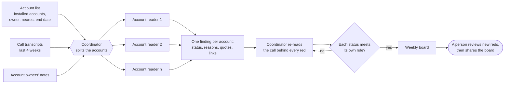

# 6. How the weekly run works

The rules can be applied by a person with a spreadsheet. They were designed for an agent run, because
nobody has time to read every installed account's calls every week. This is the shape of that run;
the code is in [`scripts/run_weekly.sh`](../scripts/run_weekly.sh), [`prompts/weekly.md`](../prompts/weekly.md)
and [`healthcheck/`](../healthcheck/).



## The roles

| Role | Job | Why this model strength |
|---|---|---|
| **Account readers** (several, in parallel) | Read every transcript in full, list who spoke on the customer side, compare tone with that customer's earlier calls, check notes for missing meetings, write one finding per account | Volume reading, every week. A mid-sized model is enough |
| **Coordinator** | Split the work, then re-open the call behind every red and downgrade anything that doesn't clearly meet the rule | The strongest model. A weaker one here produces more reds, which is the one failure that makes people stop reading the board |
| **The check** ([`validate.py`](../healthcheck/validate.py)) | Every status must meet its own rule; every reason needs a link; every quote must appear word for word in the call | Not a model. Plain rules, so it can't be talked out of a failure |
| **A person** | Look at every new red before anyone else sees it; override with a written reason when it's wrong | A wrong red reaches the account owner as an accusation |

## One finding

```json
{
  "account": "Acme Foods",
  "status": "red",
  "rule_applied": "Explicit churn signal: no value, and the pilot ends in 46 days",
  "customer_call_in_window": true,
  "headline": "Operations director says nothing is usable, and the pilot ends 1 May",
  "why": [{
    "reason": "The operations director said they will not continue unless the board sees something different by the pilot end.",
    "driver": "churn_signal",
    "weeks_present": 1,
    "relayed": false,
    "quote": "If I can't show the board something different by then, we won't continue.",
    "evidence": [{"label": "Pilot review, 2026-03-10 (03:20)", "url": "…"}]
  }],
  "support_needed": "A leadership call before 1 April with one result their own system cannot show."
}
```

`driver` is one of: churn signal, disengagement, tone, value not proven, data trust, stuck, open ask,
context. `weeks_present` and `relayed` are what make the red rule checkable.

## The board

One page per week ([example](../example-run/runs/2026-W12/board.html)):

- **Red** in full: headline, up to three reasons with quotes, the end date with days left, and what
  the escalation should ask for.
- **Yellow** and **no signal** as short cards: headline, one line, folded sources.
- **Green** as names only. Nobody needs to read the greens.
- **Recurring reasons**: any reason on two or more flagged accounts, which is a product problem,
  not an account problem.
- **Weekly trend**: every account's status for 12 weeks, and since when.

No charts and no scores, on purpose.

## Files in a run

```
output/
  history.json                 every run's statuses, keyed "YYYY-Www" (sorts across years)
  runs/2026-W12/
    roster.json                every installed account: owner, end_date, end_label
    findings_g1.json …         one per account-reader group
    overrides.json             optional: a reviewer's status changes, applied before validation
    board.html                 the board
    status.json                account → status, for this week
```

Evidence links to local files are relative to the run folder (`../../transcripts/x.md#L12`), so the
same link works for the validator and in the board. An account in an earlier week's history but not
in this week's roster is shown as **Left**: removing it from the roster is how you record a churn.

## The weekly rhythm

- **Sunday night**: the run reads the last four full weeks.
- **Monday**: one person reviews every new red, opens the quoted call, and either confirms it or
  overrides it with a reason. Then the board is shared.
- **When an account leaves**: backtest it ([05](05-backtesting.md)).
